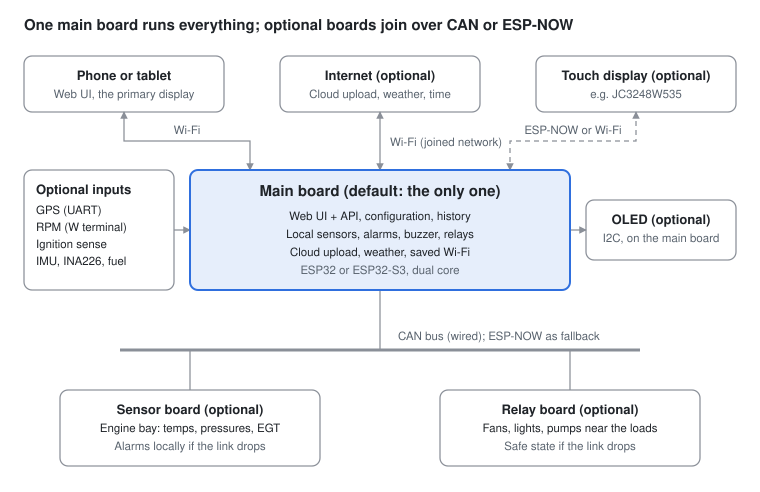

# CarMetrics v5 – Design & Backlog

Oct 31, 2026 · @Rassy Kariuki

## Purpose and principles

CarMetrics v5 grows today's single-board engine monitor into a small, modular system for older vehicles without OBD-II, such as the Land Rover 300Tdi, while one board stays the default and complete setup. Nothing here is built yet; this is the design and backlog to review before work starts.

- **One board is the default.** Every v5 feature works on a single dual-core ESP32. Extra boards are optional and add capacity, distribution or isolation.
- **Monitoring and alarms never depend on optional parts.** GPS, the touch display, extra boards, internet and the cloud can all be missing or fail without stopping sensor reading, alarms or the OLED.
- **Safety first.** Alarms are evaluated next to the sensors, and relays fall back to a defined safe state when anything upstream fails.
- **Dual-core only.** Supported chips are the ESP32 (classic) and the ESP32-S3; single-core chips are out (see Supported boards).
- **One UI.** The web app on the main board shows and configures everything, however many boards and displays are attached.
- **Optional means detected.** A missing optional module shows as "not fitted", never as an error or an alarm.

## Architecture

The main board does everything on its own; every other box is optional and plugs in without changing how the main board works.

Typical setups:

| Setup | Boards | When it fits |
| --- | --- | --- |
| Single board (default) | Main board | Today's car: everything in the cab box |
| Main + sensor board | Main board in the cab, sensor board in the engine bay over CAN | Cuts the firewall wiring to one twisted pair plus power |
| Main + relay board | Relays near the loads, over CAN | Many relays, or loads far from the cab |
| Main + sensors + relays + touch display | Up to 4 boards | Large builds; the UI still shows one combined view |

The main board always runs the web UI and API, the configuration, history, cloud upload and weather. A sensor or relay board can also be the main board when you want everything in one place.

## Supported boards

v5 supports only dual-core chips with Wi-Fi: the classic ESP32 (your current board) and the ESP32-S3. The recommended main board for new builds is an **ESP32-S3 with 8 MB PSRAM** (extra RAM); its extra memory holds longer history and bigger configurations, and it has more free pins.

| Board | Chip | Flash / PSRAM | Role fit | Notes |
| --- | --- | --- | --- | --- |
| [ESP32-S3-DevKitC-1-N8R8](https://docs.espressif.com/projects/esp-dev-kits/en/latest/esp32s3/esp32-s3-devkitc-1/user_guide.html) | ESP32-S3 | 8 MB / 8 MB | Recommended main board, any node | GPIO35–37 used by the PSRAM; ADC1 = GPIO1–10 |
| ESP32-S3-DevKitC-1-N16R8V | ESP32-S3 | 16 MB / 8 MB | Main board with a large offline buffer | 1.8 V module; GPIO35–37 reserved |
| Generic ESP32-S3 "N16R8" boards | ESP32-S3 | 16 MB / 8 MB | Main board, any node | Cheap and common; quality varies by seller |
| ESP32-DevKitC (WROOM-32E) | ESP32 | 4 MB / none | Today's board; main board or node | Fully supported, smaller history buffer |
| ESP32 WROVER-E boards | ESP32 | 4–8 MB / 8 MB | Main board or node | GPIO16/17 used by PSRAM: today's MAX6675 pins must move |

**Excluded:**

- **Single-core chips:** ESP32-C2, C3, C5, C6, H2 and S2.
- **ESP32-P4:** dual-core, but no Wi-Fi radio of its own.

**What the board profile sets:** valid pins, analog pins that work with Wi-Fi on, boot-sensitive pins, PSRAM, flash layout and default bus pins.

**Firmware platform:** v5 moves from ESP32 Arduino core 2.0.17 to core 3.x (ESP-IDF 5.x). That's needed for 1,470-byte ESP-NOW messages ([ESP-NOW docs](https://docs.espressif.com/projects/esp-idf/en/release-v5.4/esp32/api-reference/network/esp_now.html)), the current CAN driver and the touch-display graphics library (LVGL).

## Displays

The web UI on a phone or tablet is the primary display. An OLED and a touch display are both optional add-ons, and neither is needed for monitoring or alarms. All three draw from one layout model, so a widget configured once can appear on any of them.

| Display | Type | Status | Notes |
| --- | --- | --- | --- |
| Web UI (phone, tablet, laptop) | Browser | Primary, always on | Tiles, charts, settings; layout editor added in v5 |
| SSD1327 1.5" 128×128 | I2C OLED | Supported today | Your current screen |
| SSD1306 0.96" 128×64 | I2C OLED | Supported today | Pages when items don't fit |
| SH1106 1.3" 128×64 | I2C OLED | Supported today |  |
| SSD1309 2.42" 128×64 | I2C OLED | Proposed | Larger and easier to read in a moving car |
| [Guition JC3248W535](https://www.atomic14.com/esp32/boards/guition-jc3248w535/) 3.5" 320×480 | ESP32-S3 touch board | **Recommended buy** | 16 MB flash / 8 MB PSRAM, capacitive touch; needs LVGL full-refresh mode and the Arduino\_GFX graphics library |
| [Waveshare ESP32-S3-Touch-LCD-4.3](https://www.waveshare.com/esp32-s3-touch-lcd-4.3.htm) 800×480 | ESP32-S3 touch board | Recommended (larger) | Has CAN and RS485 on board, so it can join the wired bus directly |
| [Guition JC2432W328](https://www.atomic14.com/esp32/boards/guition-jc2432w328/) 2.8" 240×320 | Classic ESP32 "capacitive CYD" | Supported (budget) | No PSRAM; not pin-compatible with the original CYD |
| [ESP32-2432S028R](https://www.atomic14.com/esp32/boards/cheap-yellow-display/) 2.8" 240×320 | Classic ESP32 "Cheap Yellow Display" | Supported (budget) | Resistive touch; the USB-C "CYD2USB" revision uses an ST7789 that needs colour inversion |

**Buying advice:** skip the original yellow board and get the JC3248W535. It is the same idea on an ESP32-S3, with a bigger screen, capacitive touch and enough memory for smooth graphics.

**What the touch display does:**

- Shows its own pages from the shared layout.
- Offers mute, relay toggles, page switching and a turbo cool-down screen.
- Sets its own brightness.
- Connects over Wi-Fi to the main board's API, ESP-NOW, or CAN (on boards with a transceiver).
- If it loses the link, it shows "no data" and the rest of the system carries on.

## Board-to-board links: CAN and ESP-NOW

Support both, behind one board-to-board protocol. CAN carries anything safety-relevant and wired (engine-bay sensors, relays); ESP-NOW carries convenience and wireless links (touch displays, a node in the trailer). A board can have both, with CAN as the main path and ESP-NOW as the fallback.

|  | CAN bus (ESP32 built-in CAN controller) | ESP-NOW (Wi-Fi radio) |
| --- | --- | --- |
| Medium | One twisted pair; one spare pair of your existing CAT6 run works | Radio, no wires |
| Extra hardware | 3.3 V transceiver per board (e.g. SN65HVD230, about $2) + 120 Ω at each end | None |
| Noise and engine bay | Built for vehicles; differential signalling ignores ignition noise | Can suffer from metal bodywork and interference |
| Message size | 8 bytes per frame (classic CAN); larger messages are split | 250 bytes (v1) or 1,470 bytes (v2, newer ESP-IDF) |
| Speed | 500 kbit/s typical, up to 1 Mbit/s; every board hears every frame | A few ms per message; up to 20 paired boards, 17 encrypted |
| Channel coupling | None | Must use the same Wi-Fi channel as the network the main board joins |
| Security | Physical: you must touch the wires | Encrypted per pair (CCMP) |
| Firmware updates over it | Slow (about a minute per MB); nodes can update over Wi-Fi instead | Practical |
| Failure mode | A cut wire is detected within one heartbeat | Range or interference drop-outs |
| Best for | Sensor and relay boards, anything in the engine bay | Touch displays, temporary or hard-to-wire boards |

The CAN bus is a private CarMetrics bus, separate from any vehicle network (the 300Tdi has none anyway).

## Optional sensors and inputs

Every item below is optional and is detected at start-up. If it's absent, its features switch off and the UI says "not fitted". It never raises a fault alarm unless you have marked it as required.

| Input | Hardware | Connects to | What it enables | If absent |
| --- | --- | --- | --- | --- |
| GPS | u-blox NEO-M8N / M10 or ATGM336H module | UART (2 pins), 3.3 V | Speed, position, altitude cross-check, clock without internet, trip logs, location-tagged alarms | Speed and trip features hidden; clock from NTP or the browser |
| RPM | Alternator W terminal through a protection and conditioning stage (opto-coupler or comparator) | One GPIO using the ESP32's hardware pulse counter | Tachometer tile, "engine running" from RPM, oil pressure vs RPM, turbo timer | Engine running falls back to battery voltage |
| Ignition sense | 12 V ignition feed through a divider and opto-coupler | One GPIO (wake-capable) | Deep sleep when the key is off, clean trip start and end, turbo timer trigger | Board stays on; trips split by engine running |
| Battery current | INA226 shunt monitor | I2C | Aux battery charge and drain, fridge or winch load | Voltage only |
| Inclinometer | 6-axis IMU, e.g. ICM-42688 or MPU-6050 | I2C | Roll and pitch display for off-road use, tilt warning | Hidden |
| Fuel level | Existing resistive sender through a divider | ADC or ADS1115 channel | Fuel gauge tile, range estimate (with GPS) | Hidden |
| Warning switches | Coolant level, low oil, brake fluid | Digital inputs | Alarms from the vehicle's own switches | Hidden |
| Cabin humidity | BME280 (replaces BMP180/280) | I2C | Humidity plus today's temperature and pressure | BMP keeps working |

**RPM calibration:** the W terminal gives a fixed number of pulses per engine revolution, set by the alternator's poles and pulley ratio. Calibrate once by entering a known RPM (e.g. read from a tachometer at idle), or by typing in the ratio.

## Features

**Saved Wi-Fi networks.**

- **List:** up to 8 networks (phone hotspot, home, office), each with a priority. The board joins the best one in range.
- **Radio limit:** the ESP32 has one radio, so its own CarMetrics network follows the joined network's channel, and scanning briefly interrupts it.
- **Scan rules:** scan only when disconnected, with growing back-off, and optionally only when nobody is using the CarMetrics network.

**Board profiles.** You pick the board type in setup. The profile drives pin pickers, validation, the flash layout and the build target (`tools/cm.sh build --board s3-n8r8`).

**Board metrics.** A System panel shows, for every board:

- Uptime and the last 10 reset reasons
- Memory: free, lowest free and largest free block, plus PSRAM
- CPU load per core
- Task stack headroom
- Loop time (max and average)
- Wi-Fi signal
- Flash writes
- Link quality to other boards

These can also be uploaded as `sys_*` metrics.

**Layout editor.** One editor arranges tiles on the web dashboard, pages on the OLED, and pages on touch displays.

- **Widgets:** number, bar, round gauge, sparkline, status, relay button, mute button, turbo timer, clock.
- **Configurable:** size, order, colours by alarm level, which display shows what.

**Turbo cool-down timer** (indicator only by default):

1. When the engine is running and the vehicle stops (GPS speed 0, or RPM at idle), the display shows the EGT and a countdown.
2. It says "OK to switch off" when EGT is below your threshold and a minimum idle time has passed, with a short beep.
3. With ignition sense fitted, switching off too early logs a "hot shutdown" event.
4. An automatic timer that keeps the engine running after key-off would mean wiring a relay into the ignition and fuel cut-off. That's left out by default: unattended running is a safety risk.

**Alarm black box.** Every alarm saves the 30 s before and after it, for all sensors, to flash. You can browse it in the UI and it can be uploaded to the cloud.

**Computed sensors.** Values derived from others:

- True boost: an absolute manifold pressure sender minus BMP pressure
- Rate of change (coolant rising too fast)
- Time spent in warning
- Oil pressure against an RPM curve
- Fuel range

**Power management.** With ignition sense fitted, the board deep-sleeps when the key is off (well under 1 mA) and wakes on ignition. Otherwise it sleeps after the engine has been off for a set time.

## Data model, configuration and scaling

Everything becomes a **point** with an address of the form `board.point` (e.g. `engine.coolant_temp`, `relays.fan`). A single board uses the board name `local`, so today's sensors keep working unchanged.

- **Point kinds:** sensor, relay, computed, and system (board metrics). Sensors and relays keep today's settings: calibration, thresholds and display options.
- **Config ownership:** the main board owns the whole configuration and pushes each board its share. Boards keep a copy in their own settings storage, so they start and run without the main board.
- **Config versioning:** a schema version is stored with the config and upgraded on load. Every save keeps the previous copy for one-step rollback.
- **Live data:** a two-way WebSocket replaces today's one-way event stream, because displays and boards need to send commands back. The REST API moves to `/api/v2`, and the v1 routes stay for a release.
- **Capacity:** each layer has its own limit.

| Resource | Classic ESP32, 4 MB | ESP32-S3, 8 MB PSRAM |
| --- | --- | --- |
| Points per board (sensors + relays + computed) | \~40 | \~120 |
| Points across the whole system | \~120 | \~400 |
| Live chart history on the main board | 30 min at 5 s | Several hours at 1 s |
| Offline upload buffer | up to 400 KB | several MB on 16 MB flash |

The capacity figures are planning estimates, to be measured once built. Today's single board uses about 12 points and has about 200 KB of RAM free.

## Safety and failure behaviour

Each failure leaves monitoring running; the worst case is losing the web UI, never losing the alarms.

| Failure | What keeps working | What the driver sees |
| --- | --- | --- |
| Main board crashes or reboots | Sensor boards keep reading, alarming (buzzer/LED) and driving their own OLED | UI and touch display show "no data" |
| Link to a sensor board lost | That board alarms locally | Its points show "link lost"; a fault alert after 3 missed heartbeats |
| Link to a relay board lost | Relays go to their configured safe state (off, on, or hold) after the heartbeat timeout | Relay tiles show "link lost" |
| GPS, touch display, internet or cloud absent | Everything else | Those features show "not fitted" or "offline" |
| Bad config pushed | Board refuses it and keeps the last good config | Error shown in the UI |
| Firmware update fails or won't boot | Automatic rollback to the previous firmware slot | Notice after reboot |
| Repeated crashes at boot | Safe mode: last good config, relays off, sensors and alarms only | "Safe mode" banner |
| Voltage dip while cranking | The board's brown-out detector resets it cleanly; settings are power-fail safe | Brief restart |

Hardware rules:

- Protect every vehicle-level input (12 V, W terminal, switches) with a divider plus a TVS diode or opto-coupler.
- Fit relay boards with flyback diodes.
- Terminate the CAN bus at both ends.

## Backlog

Phase 0 lays the foundation everything else needs; phases 1–3 can then run in order, and each phase ships something usable on its own. Effort: S = days, M = 1–2 weeks, L = 3+ weeks of evenings.

| # | Item | Phase | Effort | Needs | Status |
| --- | --- | --- | --- | --- | --- |
| 1 | Move to ESP32 Arduino core 3.x (ESP-IDF 5) | 0 Foundation | M | – | Not started |
| 2 | Board profiles: ESP32, WROVER, S3 variants | 0 Foundation | M | 1 | Not started |
| 3 | Board metrics panel + `sys_*` upload | 0 Foundation | S | 1 | Not started |
| 4 | Point data model, `/api/v2`, WebSocket | 0 Foundation | L | 1 | Not started |
| 5 | Firmware rollback + safe-mode boot | 0 Foundation | S | 1 | Not started |
| 6 | Saved Wi-Fi networks (up to 8) | 1 Single board | S | 1 | Not started |
| 7 | Ignition sense + deep sleep | 1 Single board | M | 2 | Not started |
| 8 | RPM from alternator W terminal | 1 Single board | M | 2 | Not started |
| 9 | Optional GPS module | 1 Single board | M | 2, 4 | Not started |
| 10 | Turbo cool-down timer | 1 Single board | S | 8 or 9 | Not started |
| 11 | Layout editor: web tiles + OLED pages | 1 Single board | L | 4 | Not started |
| 12 | Computed sensors | 1 Single board | M | 4 | Not started |
| 13 | Alarm black box | 1 Single board | M | 4 | Not started |
| 14 | Other optional sensors: INA226, IMU, fuel level, warning switches, BME280 | 1 Single board | M | 2 | Not started |
| 15 | Touch display firmware, JC3248W535 first (LVGL) | 2 Touch display | L | 4, 11 | Not started |
| 16 | More display boards: Waveshare 4.3", CYD variants | 2 Touch display | M | 15 | Not started |
| 17 | Board-to-board protocol: heartbeat, config push, point streaming | 3 Multi-board | L | 4 | Not started |
| 18 | CAN transport (built-in controller + transceiver) | 3 Multi-board | M | 17 | Not started |
| 19 | ESP-NOW transport (v2, encrypted pairing) | 3 Multi-board | M | 17 | Not started |
| 20 | Sensor board role with local alarms | 3 Multi-board | M | 18 | Not started |
| 21 | Relay board role with safe states | 3 Multi-board | M | 18 | Not started |
| 22 | Unified UI: boards view, pairing, per-board config | 3 Multi-board | L | 17 | Not started |
| 23 | Firmware updates for other boards from the main board | 3 Multi-board | M | 17 | Not started |

Already done in v4 and carried forward: the weather tab, cloud upload with the offline buffer, altitude calibration, the MCP9600, the Docker dev environment.

## Open questions

- [ ] Main board for v5: keep the current classic ESP32, or move to an ESP32-S3 N8R8 / N16R8?
- [ ] Touch display: JC3248W535 (3.5", recommended) or Waveshare 4.3" (bigger, CAN on board)?
- [ ] Where would a second board go first: an engine-bay sensor board, or a relay board near the loads?
- [ ] Use one spare pair of the existing CAT6 run for CAN, plus another pair for power?
- [ ] GPS module and antenna position: roof, dash, or under a plastic panel?
- [ ] Turbo timer: confirm indicator-only (no automatic run-on). What EGT should count as "safe to switch off"?
- [ ] Should a missing optional sensor ever alarm, e.g. GPS fitted but no fix for 10 minutes?
- [ ] Order of phases 1–3: is the touch display (phase 2) more wanted than multi-board (phase 3)?

## Sources

- [Cheap Yellow Display family (atomic14)](https://www.atomic14.com/esp32/boards/cheap-yellow-display/)
- [Guition JC3248W535 (atomic14)](https://www.atomic14.com/esp32/boards/guition-jc3248w535/)
- [Guition JC2432W328 (atomic14)](https://www.atomic14.com/esp32/boards/guition-jc2432w328/)
- [Waveshare ESP32-S3-Touch-LCD-4.3](https://www.waveshare.com/esp32-s3-touch-lcd-4.3.htm)
- [ESP-NOW, ESP-IDF v5.4 docs](https://docs.espressif.com/projects/esp-idf/en/release-v5.4/esp32/api-reference/network/esp_now.html)
- [ESP32-S3-DevKitC-1 user guide](https://docs.espressif.com/projects/esp-dev-kits/en/latest/esp32s3/esp32-s3-devkitc-1/user_guide.html)
